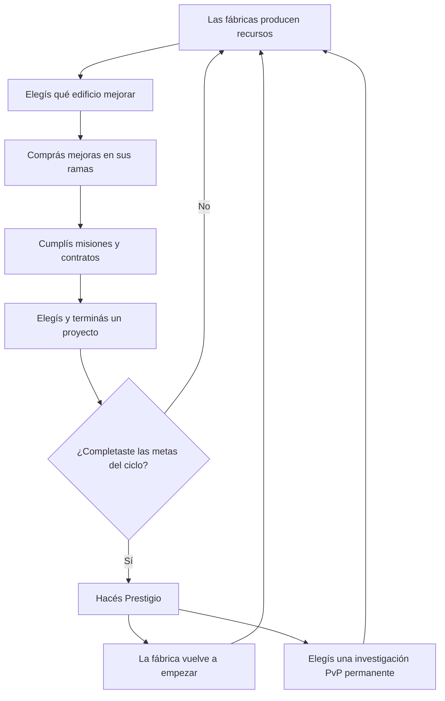

# Diseño de la Megafábrica incremental

Este documento reúne lo conversado sobre el ciclo de la Megafábrica y la propuesta de que cada fábrica tenga su propio árbol de mejoras. Describe el diseño deseado; los árboles por edificio todavía no forman parte de la implementación actual.

## La idea en palabras sencillas

La Megafábrica es un juego incremental propio. Tus fábricas producen recursos; vos elegís en qué invertirlos, qué máquinas especializar y qué objetivos completar. Cuando terminás el ciclo y hacés Prestigio, volvés a empezar la fábrica desde cero, pero conservás una investigación nueva para la Arena.

En cada ciclo podés tomar otro camino de mejoras. A largo plazo, acumulás alternativas para armar tu estrategia PvP, pero no estadísticas de combate cada vez más altas.

## El ciclo de juego



1. La producción avanza automáticamente mientras jugás y cuando volvés al juego. Las mejoras pueden hacer más rentable la producción offline de cada edificio.
2. Gastás recursos para subir máquinas y abrir mejoras en las ramas de ese edificio.
3. Las misiones y los contratos te proponen metas cortas; los proyectos son objetivos más grandes que orientan tus inversiones.
4. Al cumplir las metas requeridas, podés hacer Prestigio.
5. El Prestigio reinicia la fábrica de ese ciclo y te deja elegir una investigación PvP que todavía no tenías.
6. Esa investigación queda guardada permanentemente. Empezás otro ciclo industrial con los edificios reiniciados y una opción PvP más.

## Recursos

La fábrica debe conservar una cantidad pequeña de recursos, cada uno con una función clara. La base actual de Megafábrica v2 usa:

| Recurso | Para qué sirve |
|---|---|
| **Créditos** | Mejorar máquinas y edificios; iniciar algunos contratos. |
| **Energía** | Mejoras y contratos que requieren potencia industrial. |
| **Acero** | Mejoras mecánicas, construcción y proyectos. |
| **Intel** | Mejoras científicas e investigaciones. |

No hace falta sumar monedas nuevas para que el árbol tenga profundidad. Las decisiones pueden salir de elegir qué edificio recibe los recursos que ya producís.

## Árbol de mejoras dentro de cada fábrica

Cada edificio productor tiene un árbol propio. Sus mejoras cambian cómo trabaja ese edificio durante el ciclo actual. Algunas mejoran la máquina directamente; otras reducen costos, aceleran una tarea o aumentan lo que produce cuando el juego está cerrado.

Las ramas deben tener efectos distintos para que no haya una sola ruta obvia. Por ejemplo, podrías elegir producir más mientras estás conectado, ahorrar recursos al mejorar o especializarte en el progreso offline.

### Ejemplos de ramas

Los nombres son ejemplos para explicar el sistema; los valores y las ramas definitivas quedan por diseñar.

| Fábrica | Rama de maquinaria | Rama de eficiencia | Rama de operación offline |
|---|---|---|---|
| **Créditos / Automatización** | Mejoras para equipos de administración y venta; más Créditos por nivel. | Contratos más rentables o mejoras de esta fábrica más baratas. | Personal automático que mantiene una parte de la producción mientras no estás. |
| **Generador de Energía** | Turbinas y generadores de mayor producción. | Menos costo de Energía en ciertas mejoras o contratos. | Operadores automáticos que aumentan la Energía recuperada al volver. |
| **Refinería de Acero** | Mejores excavadores, perforadoras y procesadoras. | Más Acero por recurso invertido o menos costo de construcción. | Turnos automáticos que mantienen activa la extracción offline. |
| **Laboratorio de Intel** | Equipos y analizadores que producen más Intel. | Investigaciones o contratos científicos más eficientes. | Simulaciones autónomas que producen Intel mientras estás fuera. |

Un nodo de ejemplo podría decir: **“Excavadoras reforzadas: la Refinería produce más Acero por nivel”**. Otro podría decir: **“Turno autónomo: esta fábrica recupera un porcentaje mayor de su producción offline”**.

### Reglas para que los árboles sean decisiones

- Cada mejora debe explicar qué fábrica afecta y qué cambia.
- Las ramas pueden requerir niveles anteriores y gastar recursos distintos.
- Especializarse en una rama debería dejar menos recursos para otra, al menos durante ese ciclo.
- Algunas mejoras pueden ser excluyentes hasta el siguiente Prestigio; así, prestigiar permite probar una ruta nueva.
- Las ventajas offline deben mostrarse por edificio. La interfaz tiene que indicar cuánto produjo cada fábrica y durante cuánto tiempo.
- La producción offline mantiene un límite claro. Las mejoras pueden aumentar la eficiencia o el tiempo reconocido, pero el jugador debe poder entender ese límite.

## Misiones, contratos y proyectos

Estos sistemas dan objetivos diferentes dentro del mismo ciclo:

- **Misiones:** pasos cortos para guiar el progreso, como mejorar edificios o terminar contratos.
- **Contratos:** entregás recursos para recibir otros recursos o avanzar más rápido. Conviene mostrar el costo, el tiempo y la recompensa antes de confirmar.
- **Proyectos:** objetivos grandes, como construir un reactor, una red de drones o un centro científico. Elegir un proyecto define qué recursos conviene guardar y qué fábricas priorizar.

Los proyectos y sus recompensas pertenecen al ciclo actual y se reinician con el Prestigio. Su función es ayudarte a decidir qué construir, no conceder daño o defensa permanente en PvP.

## Prestigio: qué se pierde y qué se conserva

### Se reinicia

- niveles y ramas de mejora de los edificios;
- recursos del ciclo;
- contratos, misiones y proyecto activo;
- bonificaciones industriales temporales.

### Se conserva

- el total de Prestigios;
- las investigaciones PvP permanentes ya obtenidas.

Al prestigiar, elegís una investigación nueva entre las que todavía no desbloqueaste. Puede pertenecer a cohetes, escudos, sabotajes o bonus de Arena. Cada Prestigio agrega una opción a tu colección; no aumenta por sí solo las estadísticas del jugador.

Por ejemplo, una investigación puede desbloquear un cohete rápido y económico pero de daño bajo, mientras otra ofrece un cohete lento y potente. Tener ambas permite elegir cuál llevar a una partida; no permite disparar ambas si no las seleccionaste para ese combate.

## Cómo se conecta con la Arena

```text
Árboles de fábrica
    └── mejoran tu ciclo industrial

Misiones y proyectos
    └── te acercan al Prestigio

Prestigio
    └── desbloquea una investigación PvP permanente

Investigaciones PvP
    └── amplían las opciones para preparar el arsenal

Arena
    └── gana quien elige y usa mejor sus opciones durante la partida
```

La Megafábrica da motivos para jugar y avanzar incluso si ese día no entrás a la Arena. La Arena, a su vez, da un propósito duradero a cada Prestigio.

## Ideas para después

En charlas anteriores también aparecieron especializaciones, megaproyectos más largos, automatización de contratos, proyectos compartidos de civilización, colección visual, hitos de fábrica, eventos y temporadas. Son posibles expansiones, no requisitos para la primera versión del árbol.

La primera versión debería comprobar una idea más pequeña: **¿elegir ramas distintas por edificio cambia de verdad cómo invertís tus recursos y cómo llegás al Prestigio?** Si la respuesta es sí, después se puede ampliar con proyectos y automatizaciones más complejos.

## Estado actual

La Megafábrica v2 ya tiene producción automática, edificios con niveles, contratos, proyectos, misiones de ciclo y Prestigio con investigaciones PvP permanentes. **Los árboles de ramas independientes dentro de cada edificio, con caminos de maquinaria, eficiencia y producción offline, son la ampliación propuesta en este documento y aún deben implementarse.**
