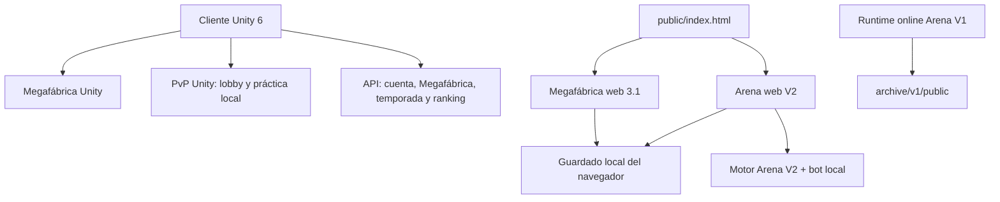

# Flujo actual de Factory Wars

## Superficies activas

## Megafábrica 3.1

La pantalla web activa es `public/factory-v2.html`; la implementación de reglas y persistencia está en `public/game/domain/factory-v2/`. El controlador web coordina producción, proyectos, contratos, misiones, prestigio e investigaciones. Unity mantiene una implementación C# separada en `unity/FactoryWars.Unity6/Assets/Scripts/`.

## Arena V2

`public/arena-v2.html` carga el controlador `public/game/adapters/web/arena-v2-controller.js`, el motor `public/game/domain/arena-v2/match-engine.js` y el bot de práctica `public/game/application/arena-v2-bot.js`. La práctica lee los desbloqueos de Megafábrica web en el mismo navegador. El motor V2 no está conectado al matchmaking ni al ranking del servidor.

El lobby y la práctica de Unity son implementaciones nativas independientes. El README de Unity documenta sus límites frente al motor V2 web y el servidor.

## Cuenta y servicios

El servidor Node.js proporciona autenticación Supabase, estado/comandos de Megafábrica, temporada y clasificación. El runtime online de Arena mantiene compatibilidad con las reglas archivadas V1. Mantenerlo bajo `archive/v1/public/` es necesario mientras `server/src/game/arena-runtime.js` dependa de él.

Para iniciar la web local, usar `python serve.py`. Para la API, configurar `.env.online` usando `.env.online.example` y seguir `docs/ONLINE_LOCAL_SETUP.md`.
