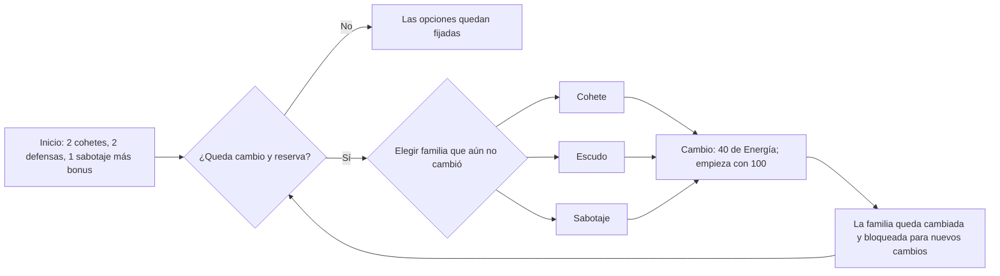
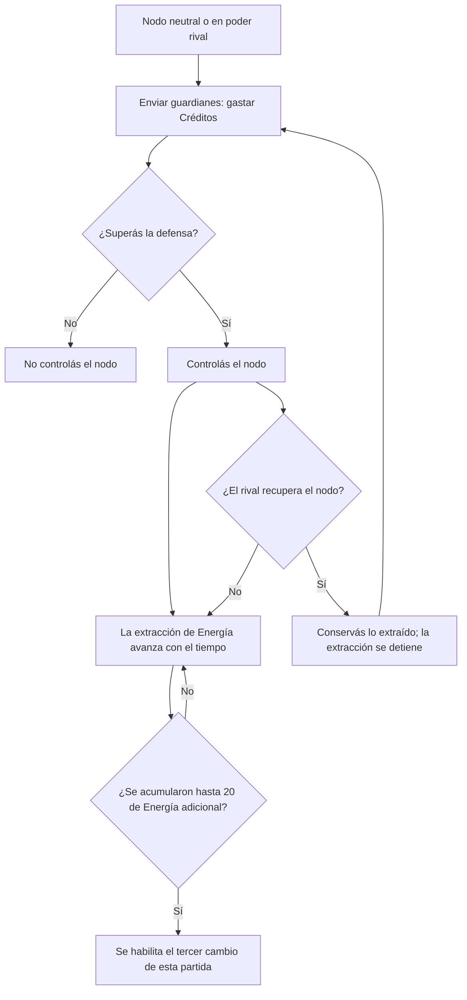
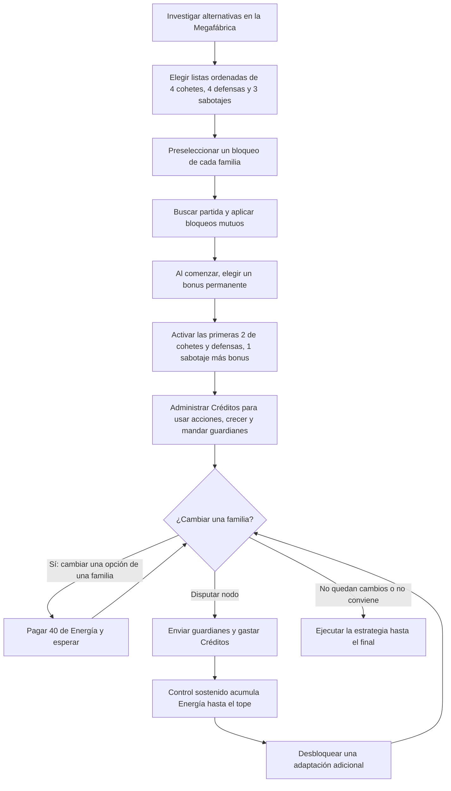

# Nuevo flujo propuesto de PvP

Este documento registra el diseño conversado de la nueva Arena. Las reglas tienen una implementación de práctica local contra bot en `public/arena-v2.html`; el estado exacto y lo pendiente se registran en `public/game/domain/arena-v2/README.md`. La Arena integrada actual sigue usando `public/game/domain/arena/`. La conexión con investigaciones persistentes, PvP online y premios sigue pendiente; el PvP de Unity continúa siendo una presentación sin combate conectado.

## La idea en una frase

Antes de entrar, cada jugador prepara su selección de cohetes, defensas y sabotajes, además de elegir los bloqueos que aplicará al rival. Al comenzar la partida elige **un bonus permanente** —por ejemplo, +15% de economía o un espacio adicional de cohetes, defensas o sabotajes— que dura hasta el final y no se puede cambiar. En combate, las opciones tácticas se pagan con Créditos y se pueden reconfigurar con Energía: empieza con 100, cada cambio cuesta 40 y el nodo puede aportar hasta 20 más para pagar el tercer cambio.

## Las tres cosas que se deciden

| Familia | Acciones normales de inicio | Qué permiten las variantes |
|---|---|---|
| **Cohetes** | Las dos primeras opciones disponibles de la lista | Reemplazar una por la tercera disponible |
| **Escudos** | Dos acciones de escudo | Reemplazar uno por una variante, como carga rápida o interceptor |
| **Sabotajes** | Una acción de sabotaje | Cambiar su efecto, por ejemplo de interferencia de escudos a económica |

Los ejemplos describen estilos, no números finales. Cada opción debe resolver una situación distinta y tener una respuesta posible. Ninguna debería ser la mejor elección en todas las partidas.

Al comenzar el combate cada jugador elige **un bonus permanente**. Puede enfocarse en economía, sumar un espacio de cohetes, defensa o sabotaje, u ofrecer otra ventaja del núcleo. Es una sola elección, permanece activa toda la partida y no se puede cambiar. Es independiente de las acciones pagadas con Créditos y de las reconfiguraciones tácticas pagadas con Energía.

## Preparación antes de empezar

### 1. Preparar las opciones

Antes de buscar partida, cada jugador prepara una lista ordenada de opciones investigadas:

- 4 opciones de cohete.
- 4 opciones de escudo.
- 3 opciones de sabotaje.

El catálogo de práctica tiene **10 cohetes, 10 escudos, 10 sabotajes y 10 bonus permanentes de economía o apoyo**. Su desbloqueo por investigaciones de la Megafábrica aún requiere integración. No se llevan las 40 opciones a una partida: antes de jugar se arma una lista ordenada de 4 cohetes, 4 defensas y 3 sabotajes. Tras los bloqueos quedan hasta tres opciones disponibles por familia. La base activa es **2 cohetes, 2 defensas y 1 sabotaje**; los restantes disponibles son reservas. Una investigación habilita alternativas, no una mejora estadística automática.

Cada jugador prepara también un bloqueo por familia para aplicarlo al rival. El bonus permanente se elige al comenzar la partida y queda fijo: por ejemplo, una mejora económica o un espacio adicional de una familia. Las ideas de abajo son una propuesta de catálogo; porcentajes, costos y duración quedan para balancear.

### Catálogo propuesto de investigaciones

Cada opción debe tener una ventaja, un costo o una situación donde sea menos útil. Los números finales no están definidos.

#### Cohetes — 10 investigaciones

| Investigación | Ventaja | Límite o respuesta rival |
|---|---|---|
| **Ráfaga** | Lanza varios impactos pequeños; presiona escudos por partes. | Cada impacto hace poco daño y puede desperdiciarse contra un escudo grande. |
| **Perforante** | Una parte del daño atraviesa escudos. | Hace menos daño total que un cohete pesado. |
| **Asedio** | Gran daño al núcleo si logra llegar. | Es lento y caro; da tiempo a defenderse. |
| **Rastreador** | Viaja rápido y castiga una defensa tardía. | Daño bajo y mala eficiencia contra escudos preparados. |
| **Rompeescudos** | Daña con más eficiencia la capacidad del escudo. | Poco daño al núcleo cuando el rival no tiene escudo activo. |
| **Pulso EMP** | Retrasa brevemente la activación de un escudo. | Casi no daña el núcleo y no cancela escudos ya desplegados. |
| **Doble vector** | Divide el ataque en dos trayectorias que llegan separadas. | Cada impacto es moderado y el costo total es alto. |
| **Carga de núcleo** | Hace daño adicional si el núcleo está expuesto. | Pierde ese bono contra escudos; no es buena apertura. |
| **Cohete económico** | Cuesta pocos Créditos y permite mantener presión. | Daño bajo y recarga larga. |
| **Disruptor de nodo** | Al impactar, retrasa por poco tiempo la llegada de guardianes enemigos. | Daño muy bajo; no quita el control del nodo por sí solo. |

#### Escudos — 10 investigaciones

| Investigación | Ventaja | Límite o respuesta rival |
|---|---|---|
| **Carga rápida** | Se activa casi al instante. | Capacidad pequeña y duración corta. |
| **Barrera pesada** | Absorbe mucho daño total. | Tarda en activarse y tiene recarga larga. |
| **Interceptor** | Reduce el daño de cada impacto absorbido. | Capacidad total moderada; sufre ante ataques sostenidos. |
| **Escudo sostenido** | Dura más tiempo. | Menos capacidad por segundo de protección. |
| **Antirráfaga** | Reduce especialmente el daño de impactos múltiples. | Es menos eficiente contra un solo impacto pesado. |
| **Antiperforante** | Reduce el daño que atraviesa escudos. | Tiene menor capacidad contra daño normal. |
| **Reactor regenerativo** | Recupera una parte pequeña de la capacidad si no recibe impactos. | Capacidad inicial baja; la ráfaga puede superarlo. |
| **Escudo reflejo** | Devuelve una fracción del daño absorbido. | Consume capacidad más rápido y protege menos el núcleo. |
| **Cobertura reforzada** | Protege mejor al núcleo durante una ventana breve. | Es caro y su ventana de uso es corta. |
| **Escudo de emergencia** | Se paga para armarlo una vez y se activa automáticamente al bajar del umbral de vida. | Tiene capacidad limitada; no se activa a voluntad ni evita un golpe letal. |

#### Sabotajes — 10 investigaciones

| Investigación | Efecto | Límite o respuesta rival |
|---|---|---|
| **Interferencia de escudos** | Reduce temporalmente los escudos ya activos. | No afecta escudos futuros ni el ingreso. |
| **Bloqueo económico** | Reduce temporalmente los ingresos de Créditos. | No destruye Créditos acumulados; duración breve. |
| **Freno industrial** | Hace más lenta la producción de Créditos. | No interrumpe acciones ni fábricas existentes. |
| **Interferencia de recargas** | Alarga las recargas de una familia por unos segundos. | No cancela acciones ya lanzadas. |
| **Retraso de lanzamiento** | Aumenta brevemente el tiempo de viaje de los cohetes enemigos. | No reduce su daño cuando llegan. |
| **Emboscada al nodo** | Retrasa la próxima llegada de guardianes rivales. | No elimina guardianes que ya controlan el nodo. |
| **Fricción de fábrica** | Aumenta el costo de la próxima fábrica enemiga. | Solo afecta una compra y puede evitarse si no construye. |
| **Corte de suministros** | Aumenta el costo de la próxima acción enemiga de una familia. | El rival puede esperar o elegir otra familia. |
| **Interferencia de reconfiguración** | Alarga la reconfiguración enemiga si ya está en curso. | No la cancela ni revela la opción elegida. |
| **Sabotaje de precisión** | Debilita temporalmente una acción activa elegida del rival. | Afecta un solo espacio y tiene una señal visible. |

#### Economía y apoyo — 10 investigaciones

Se elige **un solo bonus** al comenzar, después de resolver los bloqueos. Queda fijo durante toda la partida. Estos son los diez ejecutables del prototipo; los valores son provisionales y no tienen balance medido.

| Investigación | Ventaja | Límite o costo |
|---|---|---|
| **Rendimiento sostenido** | +15% de ingresos toda la partida. | Consume la única elección de bonus; no aumenta potencia ni reduce costos. |
| **Expansión** | +20% de ingresos durante los primeros 90 s. | Después deja de dar ingresos extra. |
| **Eficiencia** | Fábricas y mejoras económicas cuestan 12% menos. | No reduce acciones ni guardianes. |
| **Compuesto** | +0,12% de ingresos por segundo sin daño al núcleo, hasta +35%. | El daño al núcleo reinicia el crecimiento. |
| **Tesorería** | +80 Créditos iniciales. | Ventaja de una sola vez; no aumenta ingresos. |
| **Logística** | Guardianes cuestan 25% menos. | Solo beneficia la disputa del nodo. |
| **Reserva de emergencia** | Una vez entrega 100 Créditos al quedar con 35 o menos. | No se activa antes del umbral y no se repite. |
| **Espacio extra de cohetes** | Activa una tercera opción disponible de cohete. | Si ocupa todas las opciones, no queda reserva de cohete para cambiar. |
| **Espacio extra de defensa** | Activa una tercera opción disponible de defensa. | Si ocupa todas las opciones, no queda reserva de defensa para cambiar. |
| **Espacio extra de sabotaje** | Activa una segunda opción disponible de sabotaje. | Tras un bloqueo coincidente pueden quedar ambas activas y ninguna reserva. |

**Bonus permanente elegido al comenzar:** se elige uno y permanece activo toda la partida. Puede ser, por ejemplo, **+15% de ingresos**, un espacio adicional de cohetes, defensas o sabotajes, más Créditos iniciales, menor costo para enviar guardianes o una reserva de emergencia. No se compra con Energía ni reemplaza las opciones tácticas.

### 2. Bloqueos del rival

Cada jugador prepara un bloqueo del catálogo por familia: un cohete, una defensa y un sabotaje. Puede no coincidir con la lista del rival; en ese caso no elimina ninguna opción. El orden de la lista se fija antes del bloqueo.

- Si una de las primeras tres opciones de una lista de cuatro queda bloqueada, la siguiente opción avanza para completar las tres. Ejemplo: `A → B → C → D`, se bloquea `B`, queda `A → C → D`.
- Si no se bloquea ninguna de las primeras tres, se usan esas tres.
- La selección de sabotaje tiene tres opciones; al bloquear una quedan **dos**. Empezás con una y la otra queda como reserva para el único cambio de sabotaje permitido.

Las opciones disponibles alimentan la configuración principal y la alternativa de cambio de cada familia. El resultado se conoce antes de que empiece la partida; no se rehace el arsenal tras ver el bloqueo.

## Qué ocurre durante el PvP

### Recursos

- **Créditos:** sostienen la economía de la partida y pagan acciones, construcciones y envío de guardianes al nodo. Mandar guardianes tiene un costo; esos Créditos dejan de estar disponibles para otras decisiones.
- **Energía:** empieza en 100 y paga reconfiguraciones a razón de 40 por cambio. Controlar el nodo la aumenta gradualmente hasta 20 adicionales (120 como máximo). No compra ataques, economía ni mejoras económicas.
- **Guardianes:** se envían para disputar el control del nodo; invertir más guardianes implica comprometer más Créditos.

### Cambios de estrategia

Cada familia puede reconfigurarse **como máximo una vez**: cohetes, defensas y sabotajes tienen cada uno su propio cambio. El resultado del bloqueo deja hasta tres opciones disponibles por familia; durante la partida se usan **2 cohetes, 2 defensas y 1 sabotaje**, más el espacio adicional si se eligió ese bonus. Se pagan los usos con Créditos. Una reconfiguración cambia una opción activa por una reserva disponible y cuesta 40 de Energía. Si el bonus de espacio adicional deja esa familia sin reserva, no puede reconfigurarse. El bonus elegido al comenzar sigue activo y no se cambia durante la partida.

Las opciones principales son tipos reutilizables con recarga; no son munición limitada. Los usos cuestan Créditos según la economía PvP.

Los cambios se pagan con Energía, no con Créditos. Con los 100 iniciales podés pagar dos cambios (80) y te quedan 20, insuficientes para otro. Si controlás el nodo el tiempo necesario, acumulás hasta 20 adicionales: llegás a 40 disponibles y podés pagar el tercer cambio. Cada familia se cambia como máximo una vez, así que sin controlar el nodo una conserva su configuración inicial; con el nodo podés cambiar cohetes, escudos y sabotaje.



Al iniciar una reconfiguración:

1. Se anuncia al rival **qué familia** estás cambiando.
2. No se revela la nueva opción hasta que termina el proceso.
3. El cambio tarda unos segundos; durante ese tiempo el rival puede interpretar la señal.
4. Al completarse, se muestra la nueva configuración.
5. Las recargas no se reinician y los cohetes que ya salieron siguen su recorrido.

## El nodo: ganar una adaptación extra

El nodo sirve para conseguir la Energía necesaria para el tercer cambio; no entrega ingresos, daño ni escudos. Se disputa enviando guardianes, lo cual cuesta Créditos.

Mientras un jugador controla el nodo, acumula Energía gradualmente. La energía ya obtenida permanece con ese jugador si pierde el nodo. Si lo recupera, puede extraer la parte que aún no había conseguido. Hay un tope por jugador y por partida para que capturar y perder el nodo repetidamente no genere energía infinita.



El nodo aporta como máximo **20 de Energía adicional por jugador y partida**, suficiente para un solo cambio extra. Lo ya extraído se conserva si se pierde el nodo; recuperarlo permite seguir acumulando lo que falte, sin superar el tope.

La partida dura **cinco minutos**. La meta de extracción es obtener los 20 puntos cerca del minuto 3 si el nodo no se disputa y cerca del minuto 4 si hay pelea, para que todavía alcance el tiempo de usar el tercer cambio. La cantidad de guardianes y su costo en Créditos deben balancearse con ese ritmo.

## Flujo completo, de la fábrica al combate



La decisión económica sigue activa durante todo el combate: invertir Créditos en crecer, atacar/defender o disputar el nodo. El bloqueo sucede antes de jugar; la adaptación con Energía ocurre durante la partida.

## Por qué puede producir mejores decisiones

- La investigación amplía el repertorio y da objetivos a largo plazo; el bonus permanente permite definir una inclinación estratégica para la partida.
- El bloqueo permite anticipar y afectar el plan del rival antes del primer movimiento.
- Las dos adaptaciones base obligan a priorizar dos familias; no se puede responder a todo.
- El nodo permite competir por una respuesta adicional, pero cuesta Créditos que podrían acelerar otras partes de la fábrica.
- Los cambios anunciados crean una ventana de lectura y reacción, y el tiempo de reconfiguración evita cambiar instantáneamente como respuesta perfecta.

## Regla permanente entre Prestigios

La Megafábrica da acceso a investigaciones PvP mediante misiones y objetivos industriales que requieren invertir recursos. Al alcanzar Prestigio, el jugador elige **una investigación PvP nueva**. Esa investigación queda desbloqueada para siempre; los Prestigios siguientes agregan más opciones a su colección.

El Prestigio reinicia el progreso propio del ciclo industrial, pero **no borra investigaciones PvP permanentes**. Son dos progresiones separadas: la fábrica vuelve a crecer y el arsenal desbloqueado se conserva.

Las investigaciones permanentes amplían las estrategias disponibles; no dan una mejora directa y acumulativa de poder. Cada variante debe tener una ventaja y un costo, límite o respuesta. Por ejemplo, un cohete rápido puede hacer menos daño que uno lento y potente. Tener más Prestigios permite preparar más alternativas, pero no aumenta por sí solo el daño, la vida o la economía de combate.

Desbloquear una investigación tampoco la equipa automáticamente ni permite llevar todo el catálogo a una partida. Se respetan la selección previa de **4 cohetes, 4 defensas y 3 sabotajes**, los bloqueos y el único bonus elegido para esa partida. El bonus desbloqueado también debe competir en igualdad de condiciones con las demás opciones.

**Pendiente de definir:** misiones exactas, requisitos y costo de cada investigación, y cómo se concede la primera investigación antes del primer Prestigio. Esta regla de persistencia y balance ya queda fijada; su integración con la Megafábrica todavía no está implementada.

## Reglas que deben conservarse juntas

- Máximo **dos cambios base** por partida.
- El nodo puede habilitar **un tercer cambio total**, como máximo.
- Cada familia se puede cambiar una sola vez.
- Una reconfiguración cambia una opción activa por una reserva disponible de la misma familia. Sin reserva no puede cambiarse. El bonus permanente se elige al comenzar y queda activo durante toda la partida.
- El bloqueo ocurre antes de iniciar el combate; no se rehace la configuración después de ver el bloqueo.
- Un cambio no reinicia recargas ni cancela ataques en tránsito.
- Los efectos de investigación, las variantes y los valores de balance deben distinguirse; desbloquear una opción no debe convertirse accidentalmente en una mejora estadística permanente.
- Los desbloqueos PvP obtenidos por Prestigio permanecen entre ciclos y amplían opciones con compensaciones, sin acumular poder bruto.

## Números y decisiones aún por cerrar

1. **Catálogo:** el prototipo contiene 10/10/10 variantes y 10 bonus; falta conectarlos a investigaciones y fijar valores finales con balance medido.
2. **Bonus permanente:** medir economía frente a espacios adicionales de familia. En el prototipo un espacio activa una opción adicional, lo que puede dejar la familia sin reserva de cambio.
3. **Bloqueo:** definir el protocolo competitivo de confirmación e información oculta entre humanos; la práctica local revela ambas configuraciones tras resolver los bloqueos.
4. **Nodo:** definir fuerzas iniciales y balancear guardianes; con el modelo de 180 segundos de control, disputar no garantiza completar los +20 justo al minuto 4.
5. **Reconfiguración:** el prototipo paga/consume al iniciar, demora 5 s y anuncia la familia; falta medir y validar esa ventana en partidas reales.
6. **Balance:** comprobar que ataque, defensa y sabotaje tengan respuestas y momentos de uso distintos, y que la progresión de la Megafábrica no entregue ventaja automática por antigüedad.

## Resumen visual

```text
MEGAFÁBRICA
  investigo opciones ───────────────► desbloqueo un catálogo de 10 por familia

ANTES DE JUGAR
  elijo y ordeno 4 cohetes / 4 defensas / 3 sabotajes del catálogo
  preselecciono un bloqueo para cada familia del rival
                    │
  se aplican los bloqueos y las opciones siguientes avanzan
  al comenzar elijo un bonus permanente ─► queda fijo toda la partida

DURANTE LA PARTIDA
  Créditos ─► economía / acciones / guardianes
  Energía  ─► 100 iniciales; cada cambio cuesta 40
  Nodo     ─► control sostenido aporta hasta 20 para el 3.er cambio
                    │
  aviso de familia ─► espera ─► revelar opción nueva
```
