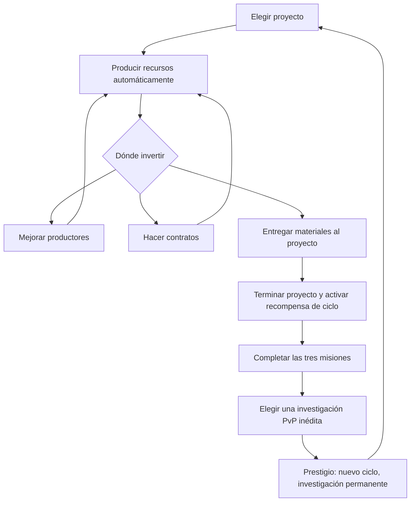

# Megafábrica v2 — práctica local

Implementación nueva y aislada. Entrada: `public/factory-v2.html`, servida por HTTP desde `public/` (por ejemplo `/factory-v2.html` si esa es la raíz del servidor). Usa módulos ESM nativos, sin build ni dependencias nuevas. El juego principal sigue usando su motor de Megafábrica. Esta práctica no conecta con Supabase ni con los guardados anteriores.

## Flujo implementado

1. Empezás con cuatro productores en nivel 1 y recursos iniciales: 350 Créditos, 100 Energía, 100 Acero y 20 Intel.
2. Elegís un proyecto entre Reactor industrial, Red de drones y Centro científico. La selección queda fija durante el ciclo.
3. Repartís recursos entre mejorar edificios, contratos y entregas al proyecto. Cada entrega usa los materiales disponibles que todavía faltan; podés completar el proyecto en varias entregas. Antes de entregar, podés invertir o reservar los materiales.
4. Los productores generan recursos por segundo sin tareas de cobro. Al volver se reconoce la ausencia hasta un límite de 4 horas. Los contratos se completan y pagan automáticamente.
5. Cumplís las tres misiones: dos mejoras de edificios, dos contratos terminados y terminar el proyecto. Las misiones muestran el progreso y bloquean el Prestigio mientras falte alguna.
6. Elegís exactamente una investigación PvP nueva y confirmás el Prestigio. La fábrica reinicia recursos, edificios, proyecto, contrato y misiones. Conservás el contador de Prestigios y todas las investigaciones ganadas.
7. El siguiente ciclo tiene los mismos valores industriales iniciales. No se usa el contador de Prestigios para aumentar poder de combate ni tasas de producción.



## Reglas y números provisionales

Los números son una base jugable local; no son evidencia de balance ni resultado de simulación.

| Productor | Recurso | Producción por nivel y segundo | Costo inicial en Créditos |
| --- | --- | --- | --- |
| Automatización | Créditos | 2 | 100 |
| Generador | Energía | 1,5 | 90 |
| Refinería | Acero | 1 | 110 |
| Laboratorio | Intel | 0,3 | 130 |

Cada mejora sube un nivel, hasta 50. El costo es `ceil(baseCost × 1.4^(nivel - 1))`. Las compras insuficientes se rechazan sin gastar recursos. Todos los productores empiezan activos; gastar todo el saldo o terminar las entregas no detiene la producción ni bloquea el ciclo.

| Proyecto | Créditos / Energía / Acero / Intel | Recompensa durante el ciclo |
| --- | --- | --- |
| Reactor industrial | 450 / 350 / 450 / 60 | +50% Energía |
| Red de drones | 600 / 300 / 350 / 90 | +35% Créditos |
| Centro científico | 450 / 250 / 300 / 150 | +50% Intel |

| Contrato | Duración | Entrega | Recompensa |
| --- | --- | --- | --- |
| Entrega urgente | 45 s | 60 Acero + 40 Energía | 110 Créditos + 8 Intel |
| Pedido industrial | 90 s | 90 Acero + 70 Energía | 190 Créditos + 16 Intel |
| Pedido científico | 150 s | 100 Acero + 100 Energía + 80 Créditos | 160 Créditos + 50 Intel |

Solo hay un contrato en curso, sin azar. Las recompensas del proyecto terminan al prestigiar. La misión de proyecto puede cumplirse con cualquiera de las tres opciones.

## Investigaciones permanentes y contrato Arena

`catalog.js` importa exclusivamente datos de `../arena-v2/balance.js`: mantiene los mismos nombres, detalles e IDs. La fábrica no modifica valores de daño, recarga, costos de combate ni efectos de Arena.

El arsenal inicial gratuito es independiente de las recompensas de Prestigio:

| Familia | IDs iniciales |
| --- | --- |
| Cohetes | `fast`, `heavy`, `burst`, `piercing` |
| Defensas | `quick`, `heavy`, `interceptor`, `sustained` |
| Sabotajes | `disrupt`, `economy`, `production` |
| Bonus | `expansion` |

Cada investigación se identifica con `familia:id`, por ejemplo `rockets:breaker`. Hay 28 opciones restantes: 6 cohetes, 6 defensas, 7 sabotajes y 9 bonus. No se pueden seleccionar investigaciones iniciales ni repetidas como premio de Prestigio. Si se agota el catálogo, el Prestigio se bloquea y la fábrica puede seguir produciendo.

Las investigaciones dan alternativas con ventajas y compensaciones. Más Prestigios amplían las estrategias disponibles; no incrementan automáticamente las estadísticas de combate. Un bonus desbloqueado queda como opción elegible; no se aplica a la fábrica ni se equipa por obtenerlo.

`exportUnlocks(state)` devuelve arsenal inicial más las investigaciones permanentes:

```json
{
  "rockets": ["fast", "heavy", "burst", "piercing"],
  "shields": ["quick", "heavy", "interceptor", "sustained"],
  "sabotage": ["disrupt", "economy", "production"],
  "bonuses": ["expansion"]
}
```

La pantalla permite copiar este JSON. **Arena v2 todavía no lo lee**: el enlace abre su práctica actual, sin sincronizar selecciones o investigaciones. La integración debe filtrar opciones elegibles conservando bloqueos, selección y límites de acciones de cada partida.

## API y guardado

- `createFactory(now)` crea el estado inicial.
- `advanceFactory(state, now)` acredita producción y el único contrato terminado; devuelve un estado nuevo.
- `executeCommand(state, command, now)` recibe `upgrade`, `selectProject`, `deliverProject`, `startContract` o `prestige` y devuelve `{state, message}`. Los comandos rechazados no modifican el estado recibido.
- `missions`, `canPrestige`, `availableResearch`, `productionRates`, `buildingCost` y `missingResources` alimentan la presentación.
- `decodeSave`, `validateState` y `encodeSave` validan versión, fechas, recursos, edificios, entregas, contratos, unicidad de investigaciones y consistencia entre recompensas y contador de Prestigios.

El dominio recibe `now` en milisegundos y no consulta reloj, navegador, storage ni red. Avanzar establece `savedAt = now`; recargar inmediatamente no duplica producción o contratos. Si el reloj retrocede, se pausa hasta que vuelva a alcanzar el guardado.

El controlador guarda en `factory-wars.factory-v2.local.v1`, formato:

```text
{schemaVersion: 1, savedAt, permanent: {prestigeCount, research}, cycle: {...}}
```

Un Prestigio conserva la recompensa y reinicia el ciclo en una sola transición y una sola escritura de `localStorage`. La UI adopta el nuevo estado solo después de que esa escritura tiene éxito. Un fallo de storage pausa las acciones. No se sobrescriben datos corruptos o de una versión futura: se muestran opciones de recarga, descarga y reinicio confirmado. El reinicio elimina también investigaciones de esta práctica, advertido en la confirmación.

Se pausa si se observa una modificación desde otra pestaña o si el valor cambia antes de escribir. Esto es una protección básica; `localStorage` no ofrece una transacción de comparación y escritura. Dos escrituras simultáneas entre pestañas aún requieren una solución de exclusión o servidor.

## Mapa de archivos y líneas

Referencias de la implementación inicial; los rangos pueden cambiar al editar.

| Archivo | Líneas | Responsabilidad |
| --- | --- | --- |
| `public/factory-v2.html` | 1–35 | Entrada, secciones y diálogo de investigación |
| `public/game/domain/factory-v2/catalog.js` | 3–23 | Guardado, productores, proyectos y contratos |
| `public/game/domain/factory-v2/catalog.js` | 24–36 | Familias, arsenal inicial e investigaciones con IDs Arena |
| `public/game/domain/factory-v2/factory-engine.js` | 8–16 | Estado inicial y comienzo del ciclo |
| `public/game/domain/factory-v2/factory-engine.js` | 17–50 | Producción, costos y avance de tiempo |
| `public/game/domain/factory-v2/factory-engine.js` | 51–65 | Misiones, requisitos y export de desbloqueos |
| `public/game/domain/factory-v2/factory-engine.js` | 66–114 | Comandos, entregas y Prestigio atómico |
| `public/game/domain/factory-v2/save-format.js` | 1–48 | Validación y serialización versionada |
| `public/game/adapters/web/factory-v2-controller.js` | 13–36 | Carga y commit con protección del guardado |
| `public/game/adapters/web/factory-v2-controller.js` | 37–80 | Presentación de recursos, decisiones y colección |
| `public/game/adapters/web/factory-v2-controller.js` | 81–110 | Acciones, elección de investigación y copia |
| `public/game/adapters/web/factory-v2-controller.js` | 111–141 | Recuperación, reset, pestañas, guardado periódico y aviso único de contrato completado |
| `public/game/presentation/styles/factory-v2.css` | 1–3 | Estilos, foco visible, diálogo y adaptación móvil |

## Estado y trabajo pendiente

Implementado: ciclo local completo de producción → decisiones económicas → proyecto/misiones → Prestigio → investigación permanente → nuevo ciclo; guardado aislado y export de opciones.

Pendiente de integración: usar esta fábrica desde el juego principal, leer sus opciones en la preparación de Arena, migrar saves previos con reglas explícitas, sincronizar con cuentas/servidor y verificar autoridad de recompensas. También quedan políticas de automatización de contratos, especializaciones, capacidad industrial, prestigio con legados industriales, colección visual, civilizaciones, temporadas y proyectos colectivos. Son ampliaciones de la propuesta; no existen en esta práctica.

Pendiente de validación: balance y tiempos, flujo completo en navegador, móvil, accesibilidad y persistencia concurrente. Se realizaron checks de sintaxis ESM de los cuatro módulos JavaScript; no se añadieron ni ejecutaron pruebas automatizadas ni se afirma verificación visual.
